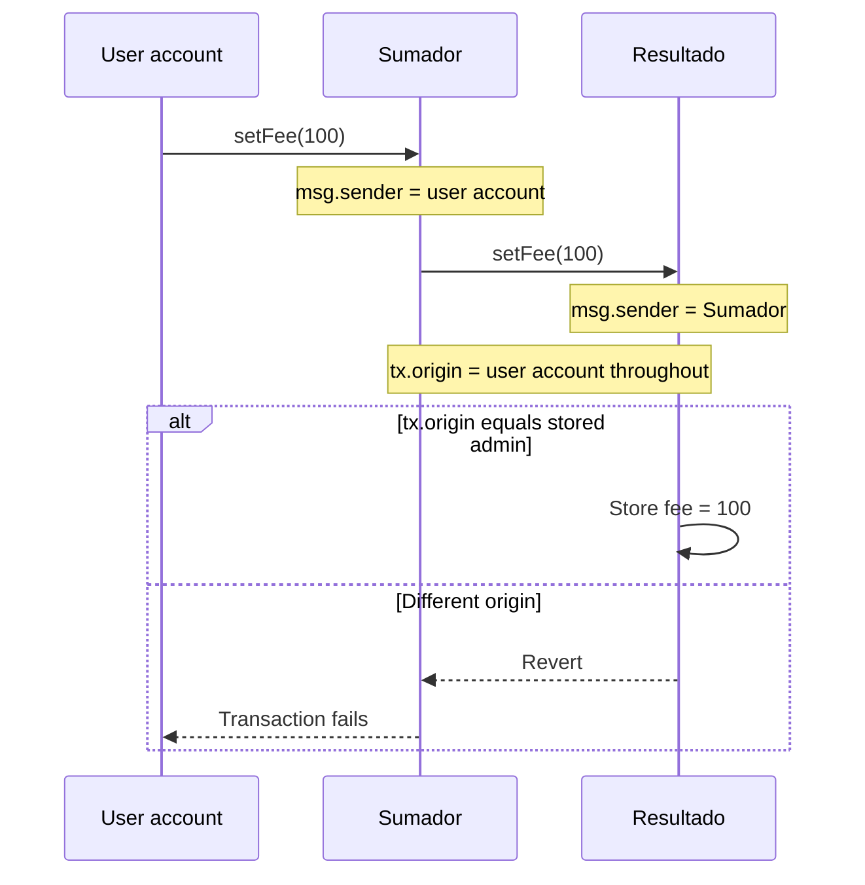

# Connected contracts and caller identity

An educational exercise from José Cruz's Blockchain Accelerator, documenting
interfaces, calls between deployed contracts and the difference between
`msg.sender` and `tx.origin`.

**Local security demonstration.** `Resultado.setFee` deliberately checks
`tx.origin` so the course example can be studied. This exposes an authorization
vulnerability. Run it in Remix VM as a learning exercise.

## Contracts

| File | Responsibility |
| --- | --- |
| [Sumador.sol](Sumador.sol) | Stores the destination address, calculates sums and forwards requests to `Resultado`. |
| [Resultado.sol](Resultado.sol) | Stores `resultado`, `admin` and `fee`. Its `setFee` checks `tx.origin`. |
| [interfaces/IResultado.sol](interfaces/IResultado.sol) | Declares the two external functions used by `Sumador`. |

Keep `IResultado.sol` inside `interfaces` to satisfy the relative import in
`Sumador.sol`. These three Solidity files are preserved as supplied.

## Call flow

For normal external calls in this exercise, the values inside `Resultado` are

| Route | `msg.sender` | `tx.origin` |
| --- | --- | --- |
| Account calls `Resultado` directly | The account | The account |
| Account calls `Sumador`, which calls `Resultado` | `Sumador` | The account |

`IResultado(resultado).setFee(newFee_)` uses the stored address and the interface
to call an existing contract. It does not deploy a new contract.

## Reproduce in Remix

1. Add the files with the same directory layout. Compile using **Solidity 0.8.24**.
2. Select **Remix VM** and keep **Value** at 0 for these operations.
3. Copy Account 1's address. Deploy `Resultado`, passing that address as `admin_`.
4. Read `admin()` and `fee()` on `Resultado`. Expect Account 1 and `5`.
5. Copy the deployed **Resultado** address. Deploy `Sumador`, passing that address
   as `resultado_`. Its `resultado()` getter should show this destination address.
6. Run the cases below and read the relevant getter again after each transaction.

| Case | Action | Expected result |
| --- | --- | --- |
| Sum across contracts | Call `Sumador.addition(5, 5)` | `Resultado.resultado()` becomes `10`. |
| Unauthorized origin | From Account 2 call `Sumador.setFee(100)` | Reverts. `Resultado.fee()` remains `5` if still at its initial value. |
| Admin origin via intermediary | From Account 1 call `Sumador.setFee(100)` | Succeeds. `Resultado.fee()` becomes `100`. |
| Admin calls directly | From Account 1 call `Resultado.setFee(20)` | Succeeds. `Resultado.fee()` becomes `20`. |
| Public setter | From Account 2 call `Resultado.setResultado(7)` | Succeeds. `Resultado.resultado()` becomes `7`. |

There are two getters named `resultado()`. On `Sumador` the result is an address.
On `Resultado` it is an integer.

## Why `tx.origin` is unsafe for authorization

Suppose the admin starts a transaction to an untrusted contract. That contract
can call `Resultado.setFee` during the same transaction. `tx.origin` still equals
the admin, so this check permits the call even though the immediate caller is
the untrusted contract. Solidity's security guidance says to never use
`tx.origin` for authorization.

The attacker needs a transaction initiated by the admin for this scenario.
Starting from the attacker's own account does not satisfy the check.

### Comparing a direct `msg.sender` check

In a separate experimental copy, replacing `tx.origin` with `msg.sender` in
`Resultado` makes a direct admin call succeed. The same admin call routed
through `Sumador` then reverts because `Resultado` sees `Sumador` as its caller.
Recompile and redeploy affected instances before comparing results.

If a design authorizes an intermediary contract, that intermediary must also
control who can request the privileged action. In this exercise,
`Sumador.setFee` is open to every caller. Trusting it without an entry-point
check would allow every account to forward the change.

## Scope and observations

- `fee` is a stored integer. The exercise does not charge a commission or move funds.
- `setFee` has no value bound. An accepted call can store `1500` as well as `5`.
- `setResultado` has no access restriction, and any account can overwrite the number.
- `admin_` is explicitly supplied at deployment. It can differ from the deployer.
- A `public` state variable gets a read function. Write permissions depend on the setters.
- Compilation and the manual cases should be repeated after changing the contracts.

## Skills practiced

Solidity interfaces, relative imports, constructor parameters, deployment order,
state updates across contract calls, `msg.sender`, `tx.origin`, access checks
and reasoning about authorization boundaries.

## Validation

Validated on 11 November 2026 using solc-js **0.8.24**, Ganache **7.9.2**
(Shanghai EVM) and ethers **6.15.0**, in an isolated local chain.

Compilation succeeded. Local execution confirmed constructor values, connected
addition, unauthorized reverts with preserved state, admin calls through
`Sumador` and directly, the unrestricted number setter and the absence of
fee bounds. A temporary comparison changing only the access check to
`msg.sender` rejected the forwarded admin request and accepted the direct
admin request. The published Solidity files retain the original course code.

These checks cover the listed learning scenarios. The example retains the
`tx.origin` vulnerability described above.

## En español

La cuenta llama a `Sumador`, y `Sumador` llama a `Resultado`. Dentro de
`Resultado`, `msg.sender` identifica a `Sumador`, mientras que `tx.origin`
identifica a la cuenta que inició la transacción. La prueba conserva el control
con `tx.origin` de la clase para entender por qué puede ser inseguro.

## References

- [Solidity 0.8.24 transaction properties](https://docs.soliditylang.org/en/v0.8.24/units-and-global-variables.html#block-and-transaction-properties)
- [Solidity 0.8.24 security guidance on tx.origin](https://docs.soliditylang.org/en/v0.8.24/security-considerations.html#tx-origin)
- [Solidity 0.8.24 interfaces](https://docs.soliditylang.org/en/v0.8.24/contracts.html#interfaces)

The code comes from course practice. The explanations and reproduction steps
were added for this portfolio.
